<div align="center">

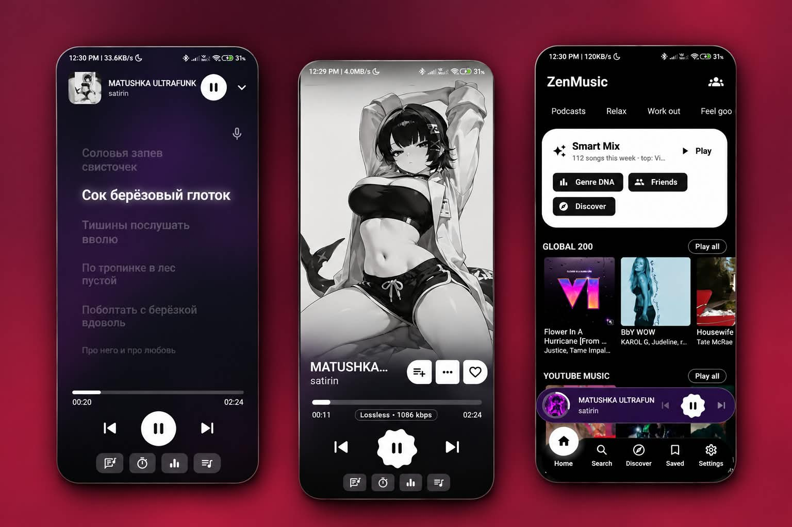

<p><b>A modern music player for Android and Windows with ad-free streaming, word-by-word synced lyrics, lossless audio, offline downloads and player skins.</b></p>

<br/>

[](https://github.com/vorlon-dev/Zen-music/releases)
[](https://github.com/vorlon-dev/Zen-music/blob/main/LICENSE)
[](https://github.com/vorlon-dev/Zen-music/releases)

<br/>

<a href="https://www.buymeachai.in/pratam" target="_blank">
  
</a>

<br/>

[**Website**](https://zenmusic-d6t.pages.dev/) · [**Download**](#download-now) · [**Features**](#features) · [**Build**](#building-from-source) · [**Troubleshooting**](#troubleshooting) · [**Contribute**](#contributing) · [**Legal**](#legal)

</div>

> [!IMPORTANT]
> ZenMusic is still in development. Features may change and you may run into bugs. Updates are delivered through GitHub Releases.
>
> The **Windows desktop version is available as an installer**: core playback, search, browsing, lyrics, the queue, Spotify integration (login, playback, playlist import) and lossless quality streaming are working.

> [!TIP]
> **Future Updates** - Coming in the next update:
> - More themes and skins
> - And many more things, very soon. Stay tuned!

> [!NOTE]
> **Regional availability** - If YouTube Music or JioSaavn is unavailable in your region, that source may not work without a **VPN or proxy** connecting to a supported region.

<div align="center"></div>

## Table of Contents

- [About](#about)
- [Screenshots](#screenshots)
- [Features](#features)
- [Supported Platforms](#supported-platforms)
- [Download Now](#download-now)
- [Installation Guide](#installation-guide)
- [Building from Source](#building-from-source)
- [Project Structure](#project-structure)
- [Configuration & Data](#configuration--data)
- [Troubleshooting](#troubleshooting)
- [FAQ](#faq)
- [Roadmap](#roadmap)
- [Contributing](#contributing)
- [Support the Project](#support-the-project)
- [Special Thanks](#special-thanks)
- [Contributors](#contributors)
- [Legal](#legal)

<div align="center"></div>

## About

**ZenMusic** is a Flutter-based music player that brings several streaming sources into one clean, fast interface. It pulls from **JioSaavn**, **YouTube Music** and **Spotify**, and wraps them in a polished player with synced lyrics, offline downloads, multiple player skins, and a Listen Together mode for syncing playback with friends.

It runs on **Android** (phone and tablet) and **Windows** (a full desktop experience with its own Spotify engine and a responsive layout).

**Design goals**

- **One app, many sources:** search and play across providers without switching apps.
- **Great playback UX:** gapless-feeling queue, sleep timer, equalizer, and lyrics that follow the song.
- **Make it yours:** player skins, slider styles, thumbnail radius, lyric layout and more.
- **Open and hackable:** GPL-3.0 licensed, so you can read, build and improve it.

<div align="center"></div>

<div align="center">

<a id="screenshots"></a>

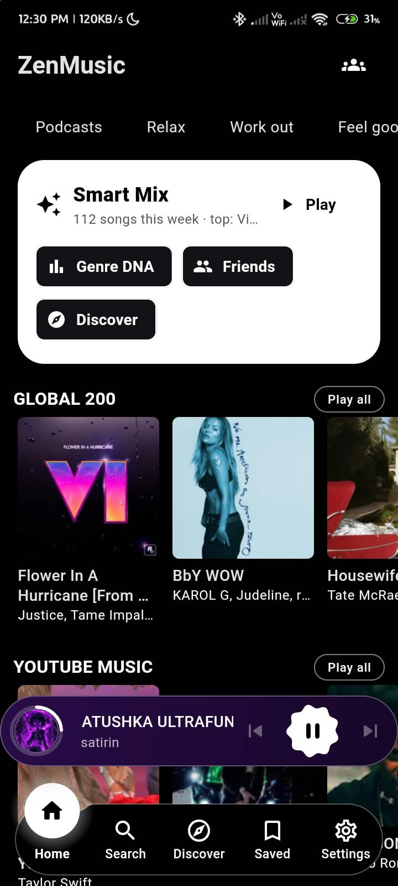
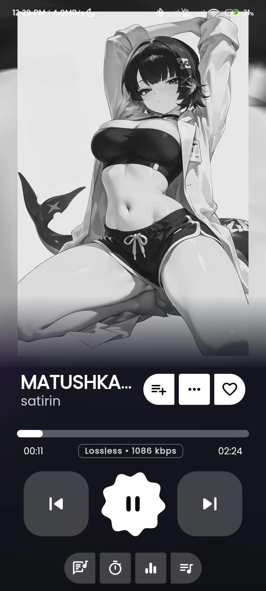
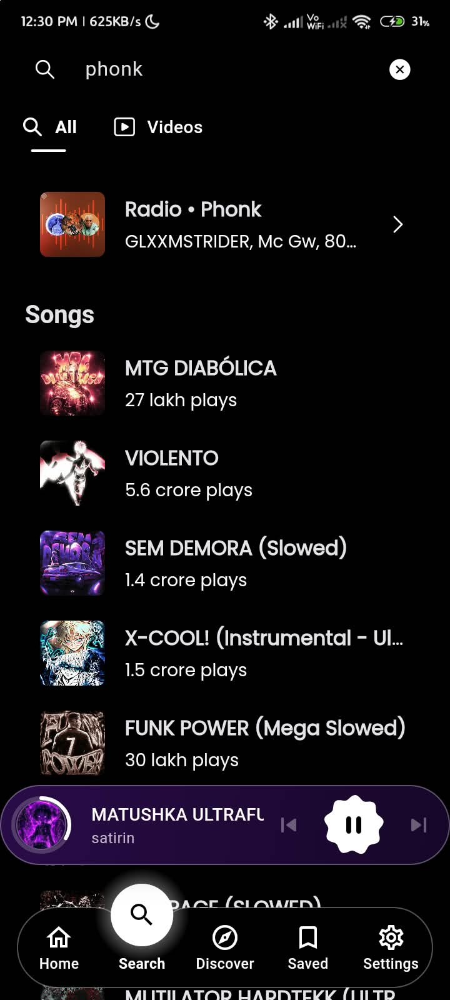
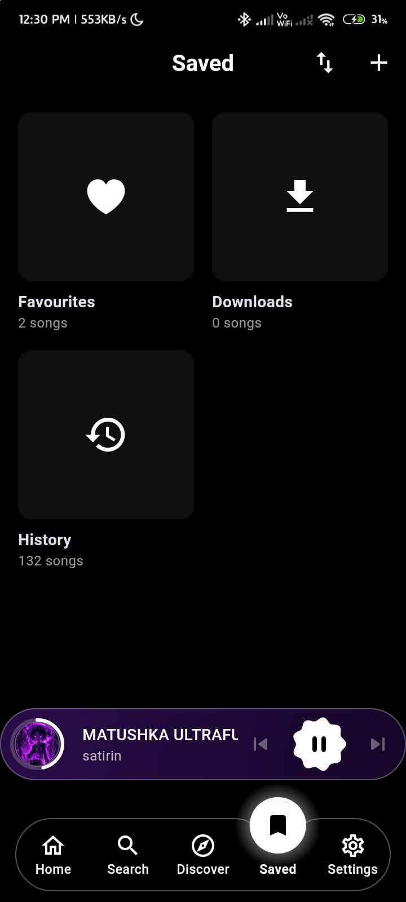
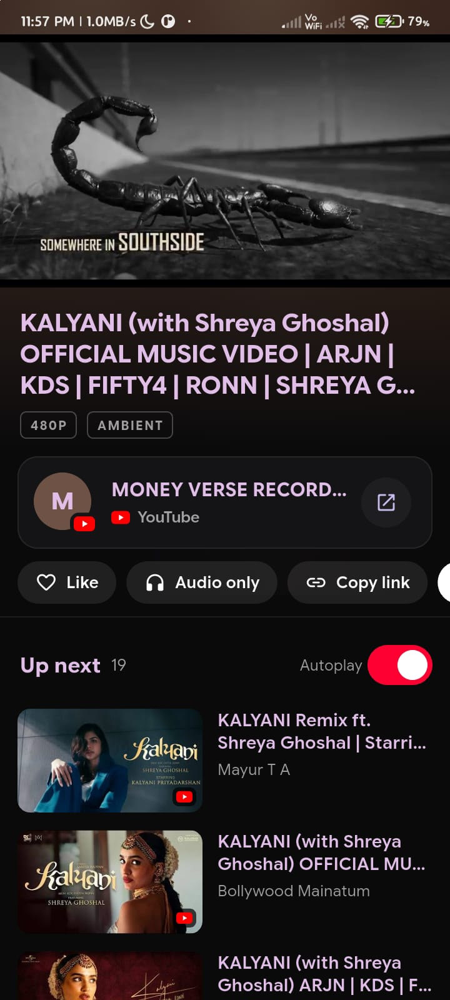
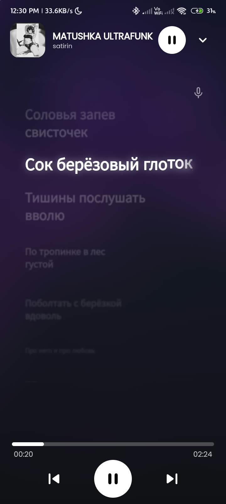
<br/>
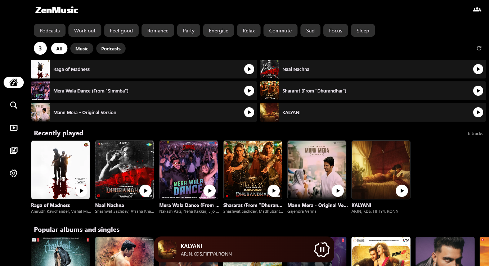
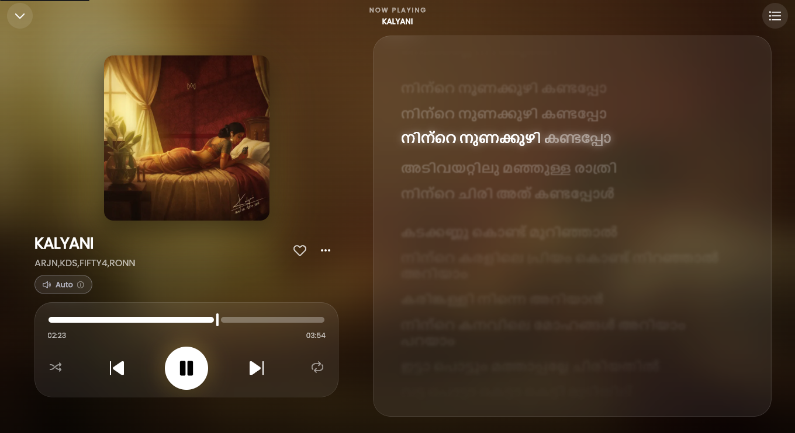
<br/>
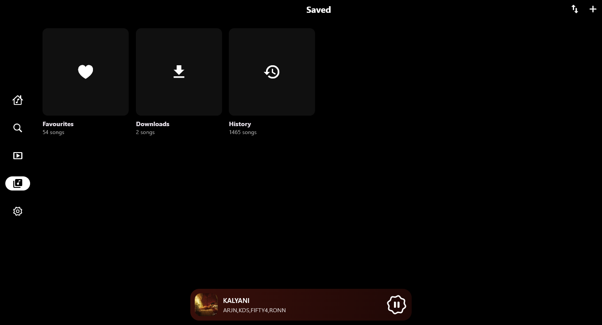
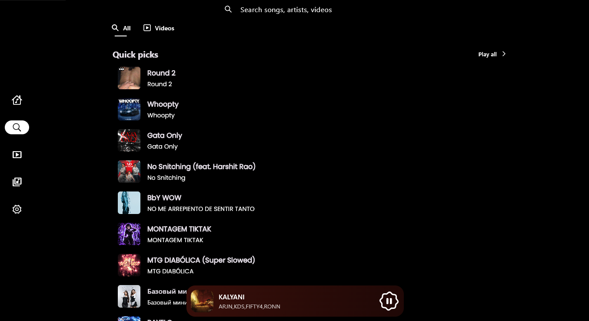

</div>

<div align="center"></div>

<div align="center">

<a id="features"></a>

</div>

> [!TIP]
> **What's new in v25.11.2026:** Echo-style player skins, a smooth player ⇄ lyrics transition, an Echo mini player, YouTube video canvas, redesigned Settings / Appearance / Equalizer / Lyric sources, and working dynamic colors. See the [release notes](release-notes/v25.11.2026.md).

<details open>
<summary><b>Streaming & Sources</b></summary>
<br>

- **Three sources in one app:** YouTube Music, JioSaavn and Spotify.
- **YouTube Music sign-in:** browse your account, library and recommendations.
- **Spotify sign-in:** play with your own account, browse your library and import playlists (Web Player protocol with Widevine DRM; custom engine on Windows).
- **Home feed:** charts, moods and genres, podcasts and YouTube Music browsing.
- **Search:** one search across sources, plus a dedicated YouTube search for videos, channels and playlists.
- **Regional workaround:** use a VPN or proxy if a source is blocked in your country.

</details>

<details open>
<summary><b>Audio Quality</b></summary>
<br>

- **Lossless streaming:** FLAC CD (16-bit / 44.1 kHz), Hi-Res (24-bit / 96 kHz) and Hi-Res Max (24-bit / 192 kHz) for YouTube Music and JioSaavn songs, plus MP3 320. Playback steps down automatically if a tier is unavailable.
- **JioSaavn 320 kbps AAC.**
- **15-band equalizer:** presets, bass boost, a live response curve and a reset button.
- **Crossfade:** true two-deck blend with an optional Automix mode that matches tempo between tracks.
- **Skip silence** and **Sing Mode** (vocal dip with an adjustable voice level, on Android).
- **Haptic Beats:** vibrate with the rhythm of the song.
- **Offline AI remix models:** optional on-device tempo models you download yourself.

</details>

<details open>
<summary><b>Lyrics</b></summary>
<br>

- **Word-by-word synced lyrics** with per-letter animation, plus line-synced lyrics.
- **Multiple sources:** LRCLIB, Better Lyrics, Musixmatch, Genius, KuGou, Lyrics+, Megalobiz, Paxsenix, Unison and more.
- **Lyric sources page:** logo for each source, word / line badges, drag to reorder, reset to default.
- **Translation and romanization:** show a translated line under each lyric, or romanize non-Latin scripts.
- **Smooth player ⇄ lyrics transition:** the cover shrinks to a corner thumbnail while the lyrics rise in; drag to scrub it.
- **Lyric style, animation, text size, line spacing and alignment** are all adjustable.
- **Lyrics overlay and Sing Mode window** on Windows: a pinned always-on-top sing-along window.
- **Keep screen on** while lyrics are showing.

</details>

<details open>
<summary><b>Player & Visuals</b></summary>
<br>

- **4 player skins:** Classic, Apple Music, Liquid Glass (SimpMusic style) and Material 3, with a preview card for each in Settings.
- **22 progress-slider styles:** Wavy, RGB Glow, Classic, Pill, Segments, Equalizer, Neon, Orbit, Heartbeat, DNA Helix, Elastic String, Liquid Tube, Constellation, Fireflies, Ripple, Spring Coil, Dot Wave, Ruler, Comet, Lightning, Glitch and Bubbles.
- **Canvas backdrops:** Spotify canvas when available, otherwise the song's own music video as a muted 20-second loop (up to 1080p), then an Instagram reel fallback.
- **Echo-style mini player on phones:** pill with a progress ring around the artwork, cookie-shaped play button and swipe to skip.
- **Dynamic colors:** the app accent follows the playing song's artwork.
- **Pure black background** for OLED screens.
- **Themes:** Classic and Liquid Glass UI, light / dark / system, accent swatches and a custom launcher logo.
- **Zen Wall and song backdrop:** full-screen visuals behind the player.
- **Adjustable thumbnail radius** and haptic feedback.

</details>

<details open>
<summary><b>Discover & Library</b></summary>
<br>

- **Smart Mix:** a daily mix built from your listening history.
- **Genre DNA and weekly recap:** see what you listen to most.
- **Discover feed:** an endless, ranked "Music Flow" built from what you play and like.
- **Library:** favourites, playback history, downloads and your own playlists.
- **Spotify library and playlists** inside the app.
- **Import playlists** from Spotify and public Apple Music links.
- **Friends feed:** see what your Last.fm friends are playing.
- **Last.fm scrobbling.**
- **Search and playback history** can be turned off or cleared.

</details>

<details open>
<summary><b>Offline & Backup</b></summary>
<br>

- **Offline downloads** with tagging, a download queue and playlist downloads.
- **Auto-cached songs** and an offline cache you can manage.
- **Backup and restore** your library and settings, and manage storage space.

</details>

<details open>
<summary><b>Social</b></summary>
<br>

- **Listen Together:** create a room, share the code and listen in sync. The host controls play, pause, seek and track changes.

</details>

<details open>
<summary><b>Settings</b></summary>
<br>

- **Redesigned settings** with grouped tiles, quick actions and real brand logos.
- **Appearance:** live theme preview, theme mode, UI theme, accent colors, dynamic colors and pure black.
- **Player settings:** equalizer, crossfade, skip silence, Sing Mode, Haptic Beats, mini player and song quality.
- **Content & region:** country, language and content type.
- **Privacy:** history and data controls.
- **About:** version and build, credits and licenses, check for updates, source code, star on GitHub, share and report a problem.

</details>

<details open>
<summary><b>Platforms</b></summary>
<br>

- **Android:** phone and tablet, with background playback, notification controls and the Echo mini player.
- **Windows 10/11:** full desktop experience with an installer, media-key and system media controls, a floating mini player, a lyrics overlay window, window backdrop effects and a responsive layout.
- **Updates:** delivered through GitHub Releases (or Obtainium on Android).

</details>

### Feature details

#### Sources

| Source | Quality | Notes |
| --- | --- | --- |
| JioSaavn | Up to 320 kbps AAC, or lossless | May require a VPN/proxy outside supported regions |
| YouTube Music | Stream-dependent, or lossless | Stream extraction via Innertube; sign in with your Google account |
| Spotify | Web Player protocol | Uses Widevine DRM; custom engine on Windows. Sign in with your own account for playback and playlist import |

#### Lossless streaming

Open **Settings → Song quality** and choose: MP3 320, FLAC CD (16-bit / 44.1 kHz), Hi-Res Lossless (24-bit / 96 kHz) or Hi-Res Max (24-bit / 192 kHz). The selected tier is the ceiling: if a song (or the service) can't provide it, playback quietly continues through the lower tiers and then the normal stream, so it never stalls. YouTube videos keep their original audio.

#### Lyrics

Lyrics are fetched from the sources you enable in **Settings → Lyric sources**, in the order you set. The first source with word-by-word timing wins when "Word timing first" is on; otherwise the first match is used. Everything else (style, size, spacing, alignment, translation, romanization) is under **Appearance** and **Lyrics**.

#### Canvas

When a song has a Spotify canvas it plays behind the player. If it doesn't (or you aren't signed in to Spotify), ZenMusic finds the song's music video on YouTube and loops a muted 20-second clip from the middle of the song, up to 1080p.

#### Listen Together

1. One person creates a room and becomes the **host**.
2. They share the room code.
3. Everyone who joins hears the same track in sync.
4. The host controls play, pause, seek and track changes for the whole room.

#### Offline downloads

Download songs for offline playback and manage them from your library. Downloaded tracks play without a network connection.

#### Player skins & appearance

Pick a skin from **Settings → Appearance → Player screen**: **Classic**, **Apple Music** (full-bleed artwork or canvas with round buttons), **Liquid Glass** (blurred backdrop with a live lyric line) or **Material 3** (connected buttons, squircle transport and a rotating cookie play button). Combine it with one of 22 progress-slider styles, an accent color, dynamic colors and pure black.

<div align="center"></div>

## Supported Platforms

| Platform | Status | Notes |
| --- | --- | --- |
| Android (phone & tablet) | Full experience | APKs via GitHub Releases and Obtainium |
| Windows 10/11 (x64) | Full desktop experience | Installer (`.exe`), custom Spotify engine, responsive UI |
| iOS / macOS / Linux | Not supported | Not currently a build target |

<div align="center"></div>

<div align="center">

<a id="download-now"></a>

<h2>Stable Release</h2>

<table>
  <tr>
    <th align="center">Obtainium (Android)</th>
    <th align="center">GitHub (Android)</th>
  </tr>
  <tr>
    <td align="center">
      <a href="https://apps.obtainium.imranr.dev/redirect?r=obtainium://add/https://github.com/vorlon-dev/Zen-music/">
        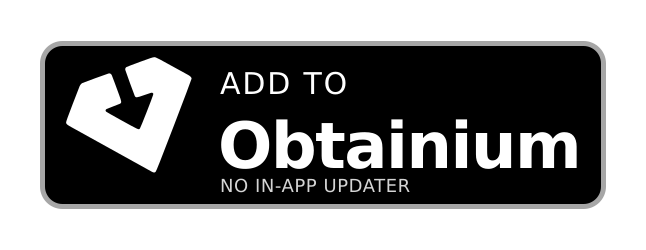
      </a>
    </td>
    <td align="center">
      <a href="https://github.com/vorlon-dev/Zen-music/releases/latest">
        
      </a>
    </td>
  </tr>
</table>

<h2>Windows (Desktop)</h2>

<table>
  <tr>
    <th align="center">Download Installer</th>
  </tr>
  <tr>
    <td align="center">
      <a href="https://github.com/vorlon-dev/Zen-music/releases/latest">
        
      </a>
      <br/>
      <p>Download the <code>.exe</code> installer from the latest Release.</p>
    </td>
  </tr>
</table>

<h2>Nightly Build</h2>

<table>
  <tr>
    <th align="center">GitHub</th>
  </tr>
  <tr>
    <td align="center">
      <a href="https://github.com/vorlon-dev/Zen-music/releases/tag/nightly">
        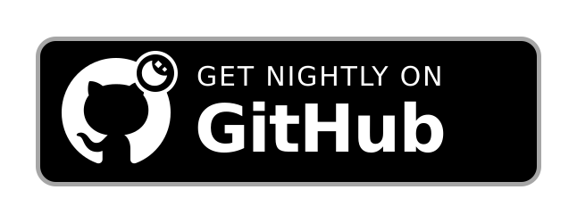
      </a>
    </td>
  </tr>
</table>

</div>

> [!WARNING]
> Nightly builds are automatically generated and may be unstable. Use the stable release unless you want the newest changes and can tolerate bugs.

<div align="center"></div>

## Installation Guide

### Android

1. Open the [latest release](https://github.com/vorlon-dev/Zen-music/releases/latest) on your phone.
2. Download the APK that matches your device. If unsure, use the universal APK; otherwise pick your ABI (usually `arm64-v8a`).
3. Open the file and allow **Install unknown apps** for your browser or file manager when prompted.
4. Launch ZenMusic.

**Tip:** Add the repository to [Obtainium](https://github.com/ImranR98/Obtainium) using the badge above to get automatic update notifications.

### Windows

1. Download the `.exe` installer from the [latest release](https://github.com/vorlon-dev/Zen-music/releases/latest).
2. Run the installer and follow the prompts.
3. If Windows SmartScreen warns about an unrecognized app, choose **More info → Run anyway**.
4. Launch ZenMusic from the Start menu.

<div align="center"></div>

<div align="center">

<a id="building-from-source"></a>


</div>

ZenMusic targets **Android and Windows**.

### Prerequisites

| Requirement | Android | Windows |
| --- | :---: | :---: |
| [Flutter SDK](https://docs.flutter.dev/get-started/install) (stable channel) | ✅ | ✅ |
| Git | ✅ | ✅ |
| Android Studio / Android SDK | ✅ | |
| Visual Studio 2022 with **Desktop development with C++** | | ✅ |
| Windows **Developer Mode** (required for plugin symlinks) | | ✅ |
| [Inno Setup](https://jrsoftware.org/isinfo.php) (only to build the installer) | | ✅ |

Run `flutter doctor -v` and make sure there are no errors for your target platform before building.

### Android

```bash
git clone https://github.com/vorlon-dev/Zen-music.git
cd Zen-music
flutter pub get
flutter run                  # with a connected Android device or emulator
```

Release APKs (what the download badges serve):

```bash
flutter build apk --release --split-per-abi   # per-ABI splits
flutter build apk --release                   # universal APK
```

### Windows (desktop)

The desktop app uses its **own entrypoint**, so always pass `-t lib/desktop/main.dart`.

1. Enable **Developer Mode** (Flutter needs it to create plugin symlinks):

   ```powershell
   start ms-settings:developers
   ```

2. Clone and run:

   ```bash
   git clone https://github.com/vorlon-dev/Zen-music.git
   cd Zen-music
   flutter pub get
   flutter run -d windows -t lib/desktop/main.dart            # dev run
   flutter build windows --release -t lib/desktop/main.dart   # release exe
   ```

The release output is written to `build\windows\x64\runner\Release\`.

#### Building the Windows installer

Install [Inno Setup](https://jrsoftware.org/isinfo.php), build the release exe as above, then compile the installer script:

```powershell
iscc windows\installer.iss
```

(Or open `windows/installer.iss` in the Inno Setup IDE and press **Compile**.)

#### Blank player screen on older GPUs

On some GPUs (older iGPUs without Vulkan), Flutter's Impeller GL backend can render custom-painted screens blank. If the player screen appears white, run development builds with:

```bash
flutter run -d windows --no-enable-impeller -t lib/desktop/main.dart
```

<div align="center"></div>

## Project Structure

A high-level overview of the parts you are most likely to touch:

```text
Zen-music/
├── lib/
│   ├── main.dart            # Android / mobile entrypoint
│   └── desktop/
│       └── main.dart        # Windows desktop entrypoint (use with -t)
├── android/                 # Android host project
├── windows/                 # Windows host project
│   └── installer.iss        # Inno Setup installer script
├── assets/                  # Banners, badges, icons used by the app and README
├── screenshots/             # Images used in this README
└── pubspec.yaml             # Dependencies and asset declarations
```

> The tree above is a simplified overview. See the repository for the full layout.

<div align="center"></div>

## Configuration & Data

- **Updates:** the app checks GitHub Releases for new versions (OTA update checks).
- **Song quality:** lossless tiers (MP3 320, FLAC CD, Hi-Res 96, Hi-Res Max) are selectable in Settings → Song quality; playback falls back automatically when a tier is unavailable.
- **Downloads:** offline songs are stored locally on the device and can be managed from the Library.
- **Lyrics:** fetched on demand from the sources you enable in Settings → Lyric sources.
- **Accounts:** Spotify uses the Web Player protocol with Widevine DRM — sign in with your own account for playback and playlist import. YouTube Music also supports account sign-in.
- **Regional access:** some sources are region-locked. Use a VPN or proxy if a source is unavailable where you live.

<div align="center"></div>

## Troubleshooting

<details>
<summary><b>Windows build fails: <code>Cannot open include file 'flutter_inappwebview_windows_fx_plugin.h'</code></b></summary>

This means the compiler cannot find the plugin's own header. It is usually a broken plugin symlink or a stale build cache.

1. Enable **Developer Mode** (`start ms-settings:developers`) and reopen your terminal.
2. Do a full clean and regenerate the plugin links:

   ```powershell
   flutter clean
   Remove-Item -Recurse -Force windows\flutter\ephemeral -ErrorAction SilentlyContinue
   Remove-Item -Recurse -Force build -ErrorAction SilentlyContinue
   flutter pub get
   flutter run -d windows --no-enable-impeller -t lib/desktop/main.dart
   ```

3. Verify the header exists in the package:

   ```powershell
   dir windows\flutter\ephemeral\.plugin_symlinks\flutter_inappwebview_windows_fx\windows\include -Recurse
   ```

4. If the project and the Pub cache (`%LOCALAPPDATA%\Pub\Cache`) are on different drives, symlinks can break. Move the project to the same drive, or point `PUB_CACHE` to a folder on the project's drive.
5. If the header is genuinely missing from the package, pin a different version of the plugin in `pubspec.yaml` and run `flutter pub get` again.

</details>

<details>
<summary><b>Player screen is blank or white on Windows</b></summary>

Run with Impeller disabled:

```bash
flutter run -d windows --no-enable-impeller -t lib/desktop/main.dart
```

</details>

<details>
<summary><b>The app builds but shows the wrong (mobile) UI on Windows</b></summary>

You forgot the desktop entrypoint. Always pass `-t lib/desktop/main.dart` for Windows runs and builds.

</details>

<details>
<summary><b>A source (YouTube Music / JioSaavn) returns no results</b></summary>

The source may be unavailable in your region. Connect through a VPN or proxy in a supported region and try again.

</details>

<details>
<summary><b>Spotify tracks will not play</b></summary>

Spotify playback relies on Widevine DRM. Make sure you are signed in with your own Spotify account, are on a supported build (Android or the Windows installer), and that your network is not blocking DRM license requests.

</details>

<details>
<summary><b>Android install is blocked</b></summary>

Allow **Install unknown apps** for the app you used to download the APK (browser or file manager) in Android settings.

</details>

<details>
<summary><b><code>flutter doctor</code> reports Visual Studio problems</b></summary>

Open the Visual Studio Installer and make sure the **Desktop development with C++** workload is installed, including the Windows 10/11 SDK and CMake tools.

</details>

<div align="center"></div>

## FAQ

**Is ZenMusic free?**
Yes. It is open source under GPL-3.0.

**Does it work on iOS, macOS or Linux?**
Not at the moment. Android and Windows are the supported targets.

**Does ZenMusic host music?**
No. It acts as a client for publicly available APIs. All content is served by the respective platforms.

**Do I need a Spotify account?**
Spotify login, playback and playlist import require signing in with your own account. Other sources work without one.

**How do I get updates?**
The app checks GitHub Releases for updates. Android users can also use Obtainium.

**Can I add my own sources?**
No. The experimental extension runtime was removed in v25.11.2026; sources are built in.

<div align="center"></div>

## Roadmap

- [ ] More themes and skins
- [x] YouTube Music login
- [x] Lossless streaming (FLAC / Hi-Res)
- [x] Spotify login and playlist import
- [x] Windows desktop app with installer
- [x] Listen Together
- [x] Time-synced lyrics
- [x] Offline downloads
- [x] Echo-style player skins and mini player
- [x] YouTube video canvas
- [x] Dynamic colors

<div align="center"></div>

<div align="center">

<a id="contributing"></a>

<h3>Contributions are welcome!</h3>

</div>

### How to contribute

1. **Fork** the repository.
2. **Create a branch** for your change:

   ```bash
   git checkout -b feature/my-feature
   ```

3. Make your changes and **commit** with a clear message.
4. **Push** to your fork and open a **Pull Request** describing what changed and why.

### Guidelines

- Keep pull requests focused on a single change.
- Test on a real device before submitting (and on Windows if you touched desktop code).
- Run `flutter analyze` and fix warnings in the files you changed.
- Match the existing code style and naming.
- When reporting a bug, include your platform, app version, steps to reproduce, and logs or screenshots if possible.

<div align="center"></div>

<div align="center">

## Credits for the BitChord-derived features

The extra lyric providers (lrc.red, BiniLyrics, PaxSenix, LyricsPlus,
Unison, Musixmatch, Megalobiz, Genius), the multi-source lyric ordering and
the two-deck crossfade / Automix design follow
[BitChord](https://github.com/kushagrasinghx/BitChord) by kushagrasinghx
(GPL-3.0), reimplemented in Dart. The lyric data itself comes from those
services; thanks to BetterLyrics, binimum (BiniLyrics, am-lyrics), PaxSenix,
LyricsPlus, Unison (boidu.dev), Megalobiz, KuGou, LRCLIB, Musixmatch and
Genius. Automix here is tempo-matched using a tempo lookup; BitChord's
on-device beat tracker (ONNX + native analysis) is not ported.

## Support the Project

ZenMusic is free and open source, and it is built in spare time. If you enjoy it and want to help keep it improving, you can buy me a chai. It is completely optional, and starring the repo or sharing the app helps just as much.

<a href="https://www.buymeachai.in/pratam" target="_blank">
  
</a>

</div>

<div align="center"></div>

<div align="center">


<h3>ZenMusic stands on the shoulders of incredible open-source work.</h3>

<h3>Main Inspirations</h3>

<table>
  <thead>
    <tr>
      <th align="center">Project</th>
      <th align="center">Contribution</th>
    </tr>
  </thead>
  <tbody>
      <td align="center"><strong>Echo music</strong></td>
      <td>basis of the Windows desktop shell</td>
    </tr>
    <tr>
      <td align="center"><strong>Stopify</strong></td>
      <td>Spotify Web Player protocol reverse-engineering and Widevine integration</td>
    </tr>
    <tr>
      <td align="center"><strong>Metrolist / metroserver</strong></td>
      <td>Listen Together server protocol and deployment</td>
    </tr>
    <tr>
      <td align="center"><strong>Musify</strong></td>
      <td>Streaming and app architecture reference</td>
    </tr>
  </tbody>
</table>

<h3>Libraries & Integrations</h3>

<table>
  <thead>
    <tr>
      <th align="center">Project</th>
      <th align="center">Contribution</th>
    </tr>
  </thead>
  <tbody>
    <tr>
      <td align="center"><code>youtube_explode_dart</code> / Innertube</td>
      <td>YouTube stream extraction</td>
    </tr>
    <tr>
      <td align="center"><code>audio_service</code> / <code>just_audio</code> / <code>media_kit</code></td>
      <td>Playback engine (Android / Windows)</td>
    </tr>
    <tr>
      <td align="center"><code>flutter_lyric</code></td>
      <td>Lyrics rendering</td>
    </tr>
    <tr>
      <td align="center"><a href="https://lrclib.net/"><strong>LRCLIB</strong></a></td>
      <td>Synced lyrics provider</td>
    </tr>
  </tbody>
</table>

<h3>We also thank the entire open-source community, for every library, tool, and API that powers this project.</h3>

</div>

<div align="center"></div>

<div align="center">

<a id="contributors"></a>

<h3>This project wouldn't exist without these amazing people!</h3>

<a href="https://github.com/vorlon-dev/Zen-music/graphs/contributors">
  
</a>

</div>

<div align="center"></div>

<div align="center">

<a id="legal"></a>

</div>

### ⚠️ Disclaimer & Legal Notice

ZenMusic is created strictly for **educational and research purposes only**.

- **No Affiliation:** This application is not affiliated with, authorized, endorsed by, or in any way officially connected with YouTube, Google LLC, JioSaavn, Spotify, or any of their subsidiaries or affiliates. All product names, logos, and brands are property of their respective owners.
- **No Hosting or Storage:** We do not host, upload, distribute, or store any audio, video, or copyrighted media files on our servers. The app acts strictly as a client that accesses publicly available APIs. All content is served directly by the respective platforms.
- **User Responsibility:** By using this software, you agree that you are solely responsible for your actions. The developers of ZenMusic are not responsible for any misuse, copyright infringement, or Terms of Service violations committed by the end user.
- **"AS IS" Warranty:** This software is provided "AS IS", without warranty of any kind, express or implied. The developers hold no liability for any legal issues, damages, or data loss that may arise from using this software.

If you do not agree with these terms, please do not download or use the application.

### License

Licensed under **GPL-3.0**. See the [LICENSE](LICENSE) file for details.

<div align="center"></div>

<div align="center">

Made with ❤️ by vorlon-dev

</div>