<div align="center">


<br/>

[](https://github.com/vorlon-dev/Zen-music/releases)
[](https://github.com/vorlon-dev/Zen-music/blob/main/LICENSE)
[](https://github.com/vorlon-dev/Zen-music/releases)

<br/>

[**Website**](https://vorlon-dev.github.io/Zen-music/) · [**Download**](#download-now) · [**Features**](#features) · [**Build**](#building-from-source) · [**Troubleshooting**](#troubleshooting) · [**Contribute**](#contributing) · [**Legal**](#legal)

</div>

> [!IMPORTANT]
> ZenMusic is still in development. Features may change and you may run into bugs. Updates are delivered through GitHub Releases.
>
> The **Windows desktop version is available as an installer**: core playback, search, browsing, lyrics, the queue, and Spotify integration are working.

> [!TIP]
> **Future Updates** - Coming in the next update:
> - **YouTube Music Login** support
> - **Lossless Quality** streaming (FLAC / Hi-Res)
> - Spotify Playlist import
> - Liquid Glass and more themes
> - And many more things, very soon. Stay tuned!

> [!NOTE]
> **Regional availability** - If YouTube Music or JioSaavn is unavailable in your region, that source may not work without a **VPN or proxy** connecting to a supported region.

<div align="center"></div>

## Table of Contents

- [About](#about)
- [Screenshots](#screenshots)
- [Features](#features)
- [Supported Platforms](#supported-platforms)
- [Download Now](#download-now)
- [Installation Guide](#installation-guide)
- [Building from Source](#building-from-source)
- [Project Structure](#project-structure)
- [Configuration & Data](#configuration--data)
- [Troubleshooting](#troubleshooting)
- [FAQ](#faq)
- [Roadmap](#roadmap)
- [Contributing](#contributing)
- [Special Thanks](#special-thanks)
- [Contributors](#contributors)
- [Legal](#legal)

<div align="center"></div>

## About

**ZenMusic** is a Flutter-based music player that brings several streaming sources into one clean, fast interface. It pulls from **JioSaavn**, **YouTube Music** and **Spotify**, and wraps them in a polished player with synced lyrics, offline downloads, multiple player skins, and a Listen Together mode for syncing playback with friends.

It runs on **Android** (phone and tablet) and **Windows** (a full desktop experience with its own Spotify engine and a responsive layout).

**Design goals**

- **One app, many sources:** search and play across providers without switching apps.
- **Great playback UX:** gapless-feeling queue, sleep timer, equalizer, and lyrics that follow the song.
- **Make it yours:** player skins, slider styles, thumbnail radius, lyric layout and more.
- **Open and hackable:** GPL-3.0, with an extension system for adding sources.

<div align="center"></div>

<div align="center">

<a id="screenshots"></a>

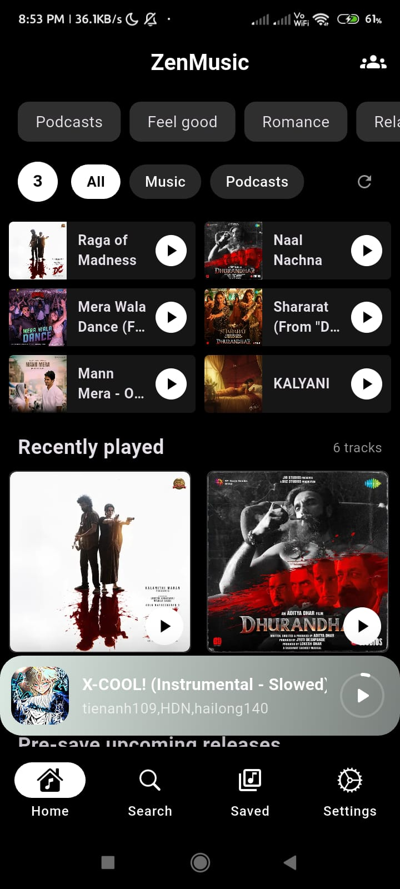
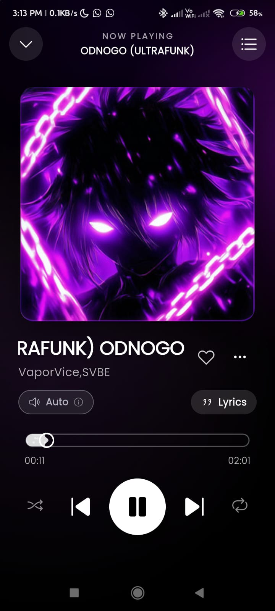
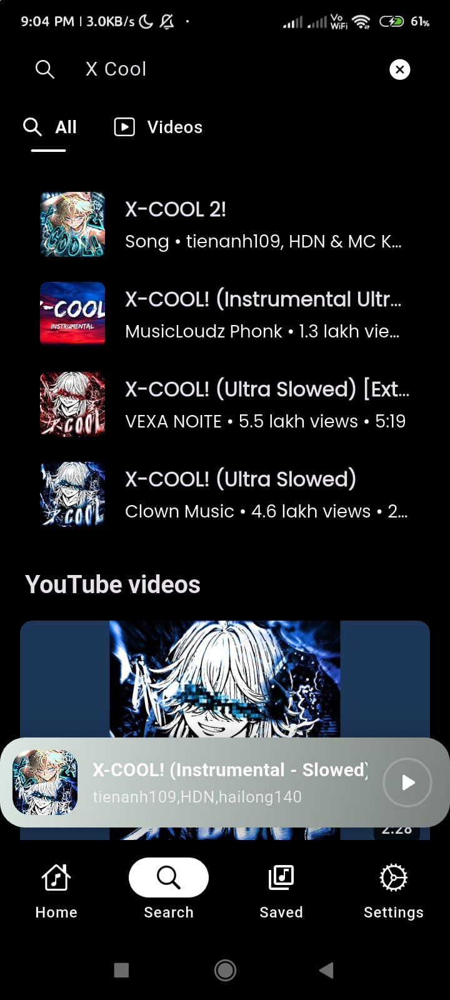
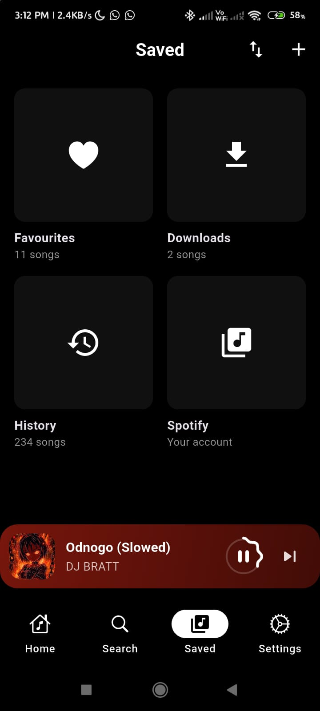
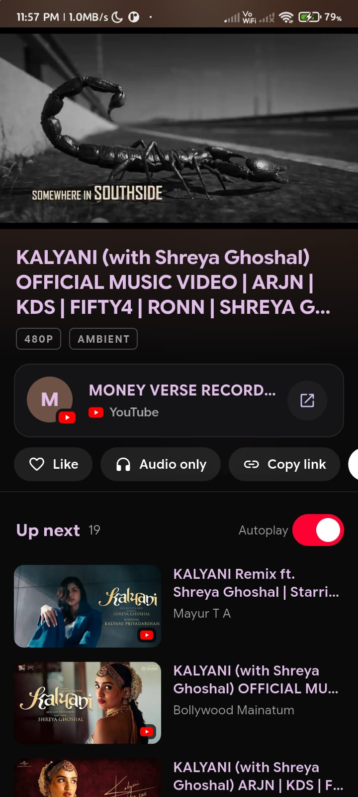
<br/>
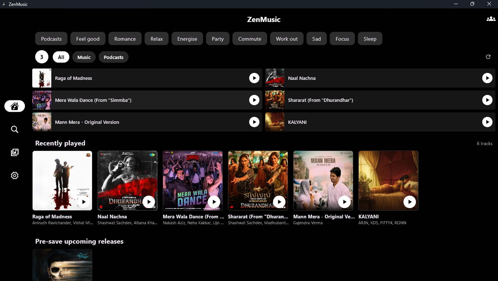
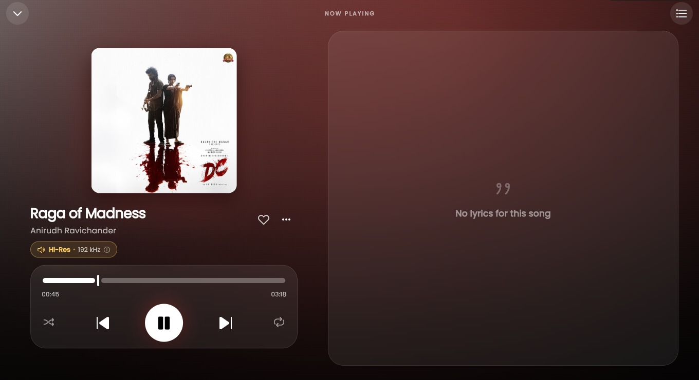
<br/>
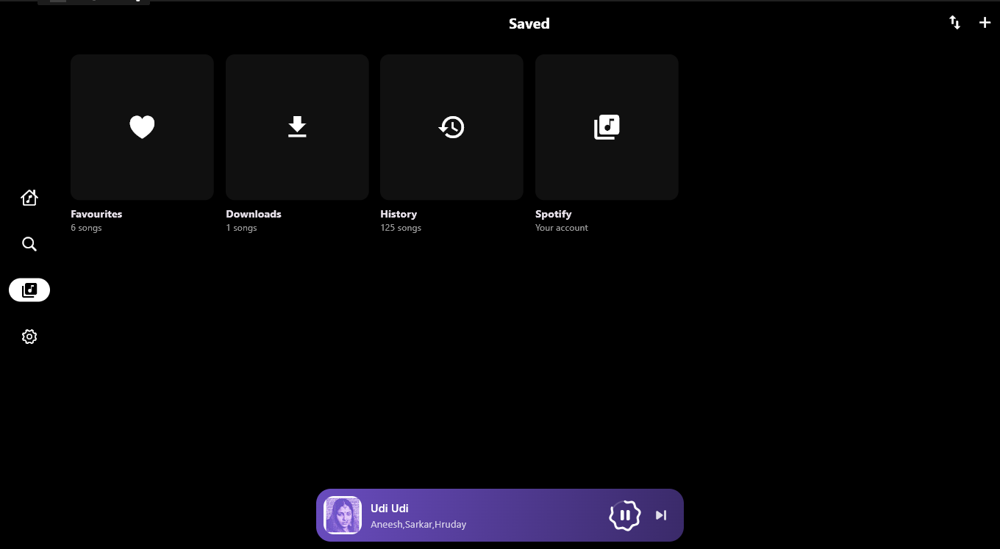
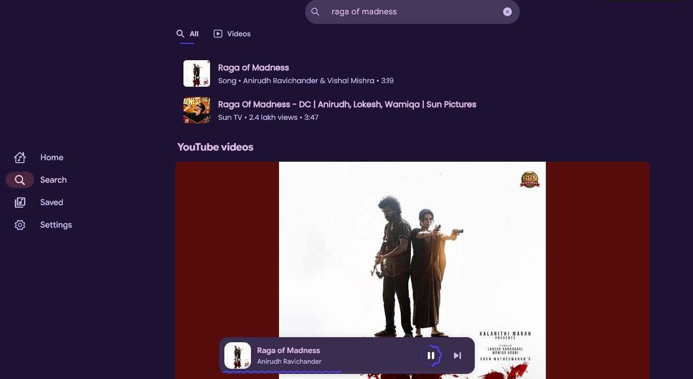

</div>

<div align="center"></div>

<div align="center">

<a id="features"></a>

</div>

<table>
  <tr>
    <td width="50%" valign="top">

#### Playback
- Multi-source streaming: JioSaavn (320 kbps AAC), YouTube Music, and Spotify
- Source extensions
- Offline downloads
- Sleep timer with end-of-song option

</td>
    <td width="50%" valign="top">

#### Audio
- System equalizer
- Bass and treble controls
- Widevine DRM (Spotify)

</td>
  </tr>
  <tr>
    <td width="50%" valign="top">

#### Lyrics & Discovery
- Time-synced lyrics (LRCLIB)
- Adjustable lyric size, spacing and alignment
- Song recognition: identify music playing around you

</td>
    <td width="50%" valign="top">

#### Library
- Import playlists from Spotify
- Download and manage songs offline

</td>
  </tr>
  <tr>
    <td width="50%" valign="top">

#### Social
- Listen Together: create a room, share the code, and listen in sync
- Host controls playback for everyone

</td>
    <td width="50%" valign="top">

#### Interface
- 6 custom player skins (Modern, Retro, CD, Cassette, Liquid Glass, Jungle)
- Ambient mode: landscape player with animated glow from album art
- Three progress slider styles
- Thumbnail radius, haptics and more
- OTA update checks via GitHub Releases

</td>
  </tr>
  <tr>
    <td colspan="2" valign="top">

#### Platforms
- **Android**: full experience (phone and tablet)
- **Windows**: full desktop experience with a custom Spotify engine, responsive UI, and an installer

</td>
  </tr>
</table>

### Feature details

#### Sources

| Source | Quality | Notes |
| --- | --- | --- |
| JioSaavn | Up to 320 kbps AAC | May require a VPN/proxy outside supported regions |
| YouTube Music | Stream-dependent | Stream extraction via Innertube; login support planned |
| Spotify | Web Player protocol | Uses Widevine DRM; custom engine on Windows |

Extra sources can be added through the **extension** system.

#### Lyrics

- Time-synced lyrics are fetched from [LRCLIB](https://lrclib.net/).
- Customize font size, line spacing and alignment to taste.
- Lyrics scroll in sync with playback and can be shown alongside the player.

#### Listen Together

1. One person creates a room and becomes the **host**.
2. They share the room code.
3. Everyone who joins hears the same track in sync.
4. The host controls play, pause, seek and track changes for the whole room.

#### Offline downloads

Download songs for offline playback and manage them from your library. Downloaded tracks play without a network connection.

#### Song recognition

Tap the recognition button to identify music playing around you. It uses a fingerprinting flow based on the Shazam discovery API.

#### Player skins & appearance

Choose between six skins: **Modern, Retro, CD, Cassette, Liquid Glass and Jungle**. Combine them with three progress-slider styles, adjustable thumbnail radius and optional haptics. **Ambient mode** switches to a landscape player with an animated glow derived from the album art.

<div align="center"></div>

## Supported Platforms

| Platform | Status | Notes |
| --- | --- | --- |
| Android (phone & tablet) | Full experience | APKs via GitHub Releases and Obtainium |
| Windows 10/11 (x64) | Full desktop experience | Installer (`.exe`), custom Spotify engine, responsive UI |
| iOS / macOS / Linux | Not supported | Not currently a build target |

<div align="center"></div>

<div align="center">

<a id="download-now"></a>

<h2>Stable Release</h2>

<table>
  <tr>
    <th align="center">Obtainium (Android)</th>
    <th align="center">GitHub (Android)</th>
  </tr>
  <tr>
    <td align="center">
      <a href="https://apps.obtainium.imranr.dev/redirect?r=obtainium://add/https://github.com/vorlon-dev/Zen-music/">
        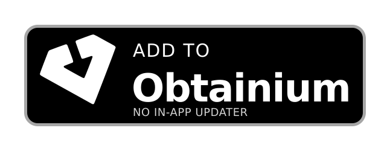
      </a>
    </td>
    <td align="center">
      <a href="https://github.com/vorlon-dev/Zen-music/releases/latest">
        
      </a>
    </td>
  </tr>
</table>

<h2>Windows (Desktop)</h2>

<table>
  <tr>
    <th align="center">Download Installer</th>
  </tr>
  <tr>
    <td align="center">
      <a href="https://github.com/vorlon-dev/Zen-music/releases/latest">
        
      </a>
      <br/>
      <p>Download the <code>.exe</code> installer from the latest Release.</p>
    </td>
  </tr>
</table>

<h2>Nightly Build</h2>

<table>
  <tr>
    <th align="center">GitHub</th>
  </tr>
  <tr>
    <td align="center">
      <a href="https://github.com/vorlon-dev/Zen-music/releases/tag/nightly">
        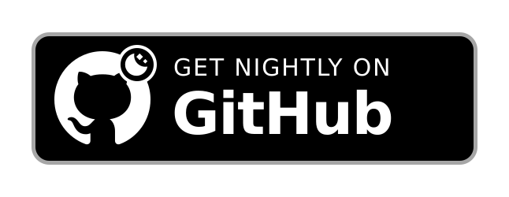
      </a>
    </td>
  </tr>
</table>

</div>

> [!WARNING]
> Nightly builds are automatically generated and may be unstable. Use the stable release unless you want the newest changes and can tolerate bugs.

<div align="center"></div>

## Installation Guide

### Android

1. Open the [latest release](https://github.com/vorlon-dev/Zen-music/releases/latest) on your phone.
2. Download the APK that matches your device. If unsure, use the universal APK; otherwise pick your ABI (usually `arm64-v8a`).
3. Open the file and allow **Install unknown apps** for your browser or file manager when prompted.
4. Launch ZenMusic.

**Tip:** Add the repository to [Obtainium](https://github.com/ImranR98/Obtainium) using the badge above to get automatic update notifications.

### Windows

1. Download the `.exe` installer from the [latest release](https://github.com/vorlon-dev/Zen-music/releases/latest).
2. Run the installer and follow the prompts.
3. If Windows SmartScreen warns about an unrecognized app, choose **More info → Run anyway**.
4. Launch ZenMusic from the Start menu.

<div align="center"></div>

<div align="center">

<a id="building-from-source"></a>


</div>

ZenMusic targets **Android and Windows**.

### Prerequisites

| Requirement | Android | Windows |
| --- | :---: | :---: |
| [Flutter SDK](https://docs.flutter.dev/get-started/install) (stable channel) | ✅ | ✅ |
| Git | ✅ | ✅ |
| Android Studio / Android SDK | ✅ | |
| Visual Studio 2022 with **Desktop development with C++** | | ✅ |
| Windows **Developer Mode** (required for plugin symlinks) | | ✅ |
| [Inno Setup](https://jrsoftware.org/isinfo.php) (only to build the installer) | | ✅ |

Run `flutter doctor -v` and make sure there are no errors for your target platform before building.

### Android

```bash
git clone https://github.com/vorlon-dev/Zen-music.git
cd Zen-music
flutter pub get
flutter run                  # with a connected Android device or emulator
```

Release APKs (what the download badges serve):

```bash
flutter build apk --release --split-per-abi   # per-ABI splits
flutter build apk --release                   # universal APK
```

### Windows (desktop)

The desktop app uses its **own entrypoint**, so always pass `-t lib/desktop/main.dart`.

1. Enable **Developer Mode** (Flutter needs it to create plugin symlinks):

   ```powershell
   start ms-settings:developers
   ```

2. Clone and run:

   ```bash
   git clone https://github.com/vorlon-dev/Zen-music.git
   cd Zen-music
   flutter pub get
   flutter run -d windows -t lib/desktop/main.dart            # dev run
   flutter build windows --release -t lib/desktop/main.dart   # release exe
   ```

The release output is written to `build\windows\x64\runner\Release\`.

#### Building the Windows installer

Install [Inno Setup](https://jrsoftware.org/isinfo.php), build the release exe as above, then compile the installer script:

```powershell
iscc windows\installer.iss
```

(Or open `windows/installer.iss` in the Inno Setup IDE and press **Compile**.)

#### Blank player screen on older GPUs

On some GPUs (older iGPUs without Vulkan), Flutter's Impeller GL backend can render custom-painted screens blank. If the player screen appears white, run development builds with:

```bash
flutter run -d windows --no-enable-impeller -t lib/desktop/main.dart
```

<div align="center"></div>

## Project Structure

A high-level overview of the parts you are most likely to touch:

```text
Zen-music/
├── lib/
│   ├── main.dart            # Android / mobile entrypoint
│   └── desktop/
│       └── main.dart        # Windows desktop entrypoint (use with -t)
├── android/                 # Android host project
├── windows/                 # Windows host project
│   └── installer.iss        # Inno Setup installer script
├── assets/                  # Banners, badges, icons used by the app and README
├── screenshots/             # Images used in this README
└── pubspec.yaml             # Dependencies and asset declarations
```

> The tree above is a simplified overview. See the repository for the full layout.

<div align="center"></div>

## Configuration & Data

- **Updates:** the app checks GitHub Releases for new versions (OTA update checks).
- **Downloads:** offline songs are stored locally on the device and can be managed from the Library.
- **Lyrics:** fetched on demand from LRCLIB.
- **Accounts:** Spotify uses the Web Player protocol with Widevine DRM; YouTube Music login is planned for an upcoming update.
- **Regional access:** some sources are region-locked. Use a VPN or proxy if a source is unavailable where you live.

<div align="center"></div>

## Troubleshooting

<details>
<summary><b>Windows build fails: <code>Cannot open include file 'flutter_inappwebview_windows_fx_plugin.h'</code></b></summary>

This means the compiler cannot find the plugin's own header. It is usually a broken plugin symlink or a stale build cache.

1. Enable **Developer Mode** (`start ms-settings:developers`) and reopen your terminal.
2. Do a full clean and regenerate the plugin links:

   ```powershell
   flutter clean
   Remove-Item -Recurse -Force windows\flutter\ephemeral -ErrorAction SilentlyContinue
   Remove-Item -Recurse -Force build -ErrorAction SilentlyContinue
   flutter pub get
   flutter run -d windows --no-enable-impeller -t lib/desktop/main.dart
   ```

3. Verify the header exists in the package:

   ```powershell
   dir windows\flutter\ephemeral\.plugin_symlinks\flutter_inappwebview_windows_fx\windows\include -Recurse
   ```

4. If the project and the Pub cache (`%LOCALAPPDATA%\Pub\Cache`) are on different drives, symlinks can break. Move the project to the same drive, or point `PUB_CACHE` to a folder on the project's drive.
5. If the header is genuinely missing from the package, pin a different version of the plugin in `pubspec.yaml` and run `flutter pub get` again.

</details>

<details>
<summary><b>Player screen is blank or white on Windows</b></summary>

Run with Impeller disabled:

```bash
flutter run -d windows --no-enable-impeller -t lib/desktop/main.dart
```

</details>

<details>
<summary><b>The app builds but shows the wrong (mobile) UI on Windows</b></summary>

You forgot the desktop entrypoint. Always pass `-t lib/desktop/main.dart` for Windows runs and builds.

</details>

<details>
<summary><b>A source (YouTube Music / JioSaavn) returns no results</b></summary>

The source may be unavailable in your region. Connect through a VPN or proxy in a supported region and try again.

</details>

<details>
<summary><b>Spotify tracks will not play</b></summary>

Spotify playback relies on Widevine DRM. Make sure you are on a supported build (Android or the Windows installer) and that your network is not blocking DRM license requests.

</details>

<details>
<summary><b>Android install is blocked</b></summary>

Allow **Install unknown apps** for the app you used to download the APK (browser or file manager) in Android settings.

</details>

<details>
<summary><b><code>flutter doctor</code> reports Visual Studio problems</b></summary>

Open the Visual Studio Installer and make sure the **Desktop development with C++** workload is installed, including the Windows 10/11 SDK and CMake tools.

</details>

<div align="center"></div>

## FAQ

**Is ZenMusic free?**
Yes. It is open source under GPL-3.0.

**Does it work on iOS, macOS or Linux?**
Not at the moment. Android and Windows are the supported targets.

**Does ZenMusic host music?**
No. It acts as a client for publicly available APIs. All content is served by the respective platforms.

**Do I need a Spotify account?**
Spotify features require signing in with your own account. Other sources work without one.

**How do I get updates?**
The app checks GitHub Releases for updates. Android users can also use Obtainium.

**Can I add my own sources?**
Yes. ZenMusic supports source extensions.

<div align="center"></div>

## Roadmap

- [ ] YouTube Music login
- [ ] Lossless streaming (FLAC / Hi-Res)
- [ ] Spotify playlist import
- [ ] Liquid Glass and additional themes
- [x] Windows desktop app with installer
- [x] Listen Together
- [x] Time-synced lyrics
- [x] Offline downloads
- [x] Song recognition

<div align="center"></div>

<div align="center">

<a id="contributing"></a>

<h3>Contributions are welcome!</h3>

</div>

### How to contribute

1. **Fork** the repository.
2. **Create a branch** for your change:

   ```bash
   git checkout -b feature/my-feature
   ```

3. Make your changes and **commit** with a clear message.
4. **Push** to your fork and open a **Pull Request** describing what changed and why.

### Guidelines

- Keep pull requests focused on a single change.
- Test on a real device before submitting (and on Windows if you touched desktop code).
- Run `flutter analyze` and fix warnings in the files you changed.
- Match the existing code style and naming.
- When reporting a bug, include your platform, app version, steps to reproduce, and logs or screenshots if possible.

<div align="center"></div>

<div align="center">


<h3>ZenMusic stands on the shoulders of incredible open-source work.</h3>

<h3>Main Inspirations</h3>

<table>
  <thead>
    <tr>
      <th align="center">Project</th>
      <th align="center">Contribution</th>
    </tr>
  </thead>
  <tbody>
    <tr>
      <td align="center"><strong>Echo nightly</strong></td>
      <td>Extension implementation</td>
    </tr>
    <tr>
      <td align="center"><strong>Echo music</strong></td>
      <td>UI design language, Listen Together client, recognition engine, Apple Music canvas and welcome dialog; basis of the Windows desktop shell</td>
    </tr>
    <tr>
      <td align="center"><strong>Stopify</strong></td>
      <td>Spotify Web Player protocol reverse-engineering and Widevine integration</td>
    </tr>
    <tr>
      <td align="center"><strong>Metrolist / metroserver</strong></td>
      <td>Listen Together server protocol and deployment</td>
    </tr>
    <tr>
      <td align="center"><strong>Musify</strong></td>
      <td>Streaming and app architecture reference</td>
    </tr>
  </tbody>
</table>

<h3>Libraries & Integrations</h3>

<table>
  <thead>
    <tr>
      <th align="center">Project</th>
      <th align="center">Contribution</th>
    </tr>
  </thead>
  <tbody>
    <tr>
      <td align="center"><code>youtube_explode_dart</code> / Innertube</td>
      <td>YouTube stream extraction</td>
    </tr>
    <tr>
      <td align="center"><code>audio_service</code> / <code>just_audio</code> / <code>media_kit</code></td>
      <td>Playback engine (Android / Windows)</td>
    </tr>
    <tr>
      <td align="center"><code>flutter_lyric</code></td>
      <td>Lyrics rendering</td>
    </tr>
    <tr>
      <td align="center"><a href="https://lrclib.net/"><strong>LRCLIB</strong></a></td>
      <td>Synced lyrics provider</td>
    </tr>
    <tr>
      <td align="center"><strong>Shazam discovery API / dejavu-fingerprinter</strong></td>
      <td>Song recognition</td>
    </tr>
    <tr>
      <td align="center"><strong>Music Recognizer</strong></td>
      <td>Recognition flow reference</td>
    </tr>
  </tbody>
</table>

<h3>We also thank the entire open-source community, for every library, tool, and API that powers this project.</h3>

</div>

<div align="center"></div>

<div align="center">

<a id="contributors"></a>

<h3>This project wouldn't exist without these amazing people!</h3>

<a href="https://github.com/vorlon-dev/Zen-music/graphs/contributors">
  
</a>

</div>

<div align="center"></div>

<div align="center">

<a id="legal"></a>

</div>

### ⚠️ Disclaimer & Legal Notice

ZenMusic is created strictly for **educational and research purposes only**.

- **No Affiliation:** This application is not affiliated with, authorized, endorsed by, or in any way officially connected with YouTube, Google LLC, JioSaavn, Spotify, or any of their subsidiaries or affiliates. All product names, logos, and brands are property of their respective owners.
- **No Hosting or Storage:** We do not host, upload, distribute, or store any audio, video, or copyrighted media files on our servers. The app acts strictly as a client that accesses publicly available APIs. All content is served directly by the respective platforms.
- **User Responsibility:** By using this software, you agree that you are solely responsible for your actions. The developers of ZenMusic are not responsible for any misuse, copyright infringement, or Terms of Service violations committed by the end user.
- **"AS IS" Warranty:** This software is provided "AS IS", without warranty of any kind, express or implied. The developers hold no liability for any legal issues, damages, or data loss that may arise from using this software.

If you do not agree with these terms, please do not download or use the application.

### License

Licensed under **GPL-3.0**. See the [LICENSE](LICENSE) file for details.

<div align="center"></div>

<div align="center">

Made with ❤️ by vorlon-dev

</div>